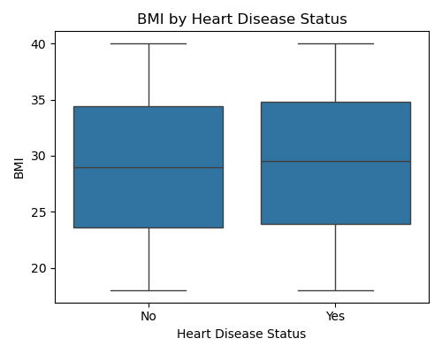
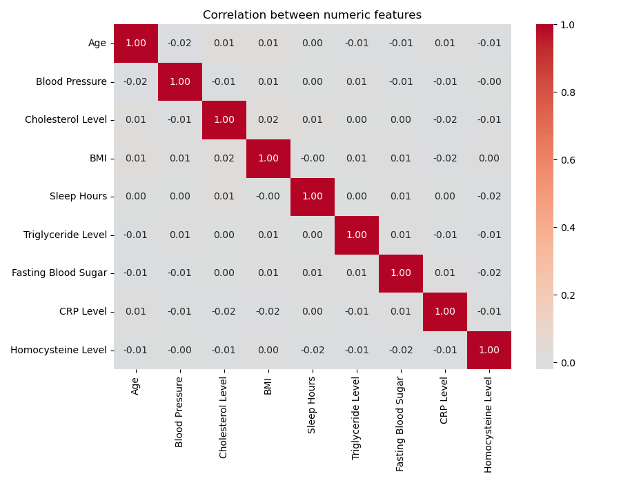

# No Learnable Signal in a Public Heart Disease Dataset

A **negative-result / data-validation study**. I set out to predict heart disease from 20 health
features, and found that **this dataset cannot do it**: every model, linear or non-linear, scores
ROC-AUC ≈ 0.50 (random guessing), and a permutation test confirms the models do no better on the real
labels than on shuffled ones. The data is most likely synthetic, with labels that do not depend on the
features. This repository documents the evidence.

📄 **Full write-up with all figures and discussion: [report.pdf](report.pdf)**

---

## Dataset

- **Source:** [Heart Disease – Kaggle (Oktay Ördekçi)](https://www.kaggle.com/datasets/oktayrdeki/heart-disease), file `heart_disease.csv`
- **Shape:** 10,000 rows × 21 columns (20 features + target `Heart Disease Status`)
- **Features:** 9 numeric (age, blood pressure, cholesterol, BMI, sleep hours, triglycerides,
  fasting blood sugar, CRP, homocysteine) and 11 categorical (gender, smoking, diabetes, stress level, …)
- **Class balance:** 80% "No" / 20% "Yes". A model that always predicts "No" scores 80% accuracy.
- **Missing values:** about 0.2–0.3% per column, except `Alcohol Consumption` (about 26%)

> **The data is not included in this repository.** The Kaggle page lists the license as
> "Other (specified in description)", but the description does not specify one, so redistribution
> is not clearly permitted. To run the code, download `heart_disease.csv` from the Kaggle link above and
> place it in the project root.

## Method

1. **EDA** (`EDA.py`): missing values (including whether missingness relates to the target),
   duplicates, class balance, IQR outliers, impossible values, skewness, a "Table 1" comparison
   of the two classes (Mann-Whitney U / chi-square), plus histograms, box plots and a correlation heatmap.
2. **Leakage-safe preprocessing:** a scikit-learn `Pipeline` with median imputation and scaling for
   numeric features, and a "Missing" category plus one-hot encoding for categorical features. It is
   fitted inside each cross-validation fold.
3. **Models** (`model.py`): a majority-class **Dummy baseline**, Logistic Regression, Random Forest,
   Gradient Boosting and SVM (RBF), all with `class_weight="balanced"`. Tree ensembles are included
   because they capture non-linear effects and feature interactions that correlation cannot see.
4. **Evaluation:** stratified 5-fold cross-validation with **imbalance-aware metrics**: ROC-AUC, PR-AUC,
   recall, precision and F1. Accuracy is reported only to show why it misleads.
5. **Permutation test:** the labels are shuffled 100 times to measure what "no relationship" looks like,
   and the real score is compared against that distribution.

## Results

Stratified 5-fold cross-validation (mean ± std):

| Model               | ROC-AUC       | PR-AUC        | Recall        | Precision     | F1            | Accuracy      |
|---------------------|---------------|---------------|---------------|---------------|---------------|---------------|
| Dummy (baseline)    | 0.500 ± 0.000 | 0.200 ± 0.000 | 0.000 ± 0.000 | 0.000 ± 0.000 | 0.000 ± 0.000 | 0.800 ± 0.000 |
| Logistic Regression | 0.503 ± 0.013 | 0.203 ± 0.009 | 0.481 ± 0.019 | 0.201 ± 0.007 | 0.284 ± 0.010 | 0.514 ± 0.006 |
| Random Forest       | 0.503 ± 0.016 | 0.204 ± 0.008 | 0.000 ± 0.000 | 0.000 ± 0.000 | 0.000 ± 0.000 | 0.800 ± 0.000 |
| Gradient Boosting   | 0.490 ± 0.008 | 0.200 ± 0.005 | 0.234 ± 0.016 | 0.192 ± 0.009 | 0.211 ± 0.011 | 0.650 ± 0.010 |
| SVM                 | 0.496 ± 0.008 | 0.202 ± 0.008 | 0.400 ± 0.018 | 0.197 ± 0.008 | 0.264 ± 0.011 | 0.553 ± 0.007 |

- **No model beats the dummy baseline.** ROC-AUC is 0.49–0.50 and PR-AUC equals the 20% positive rate.
- **Permutation test (Logistic Regression):** real AUC 0.503 vs. shuffled AUC 0.500 ± 0.010,
  **p ≈ 0.41**, which is no better than chance.
- **Univariate tests:** the class means are nearly identical on every feature. Only BMI (p ≈ 0.05) and
  Stress Level (p ≈ 0.02) are below 0.05, and neither survives a Bonferroni correction for 20 tests
  (threshold 0.0025).
- **Signs of synthetic data:** every numeric feature is uniformly distributed between round bounds,
  with skewness ≈ 0 and zero outliers.

<p align="center">
  
  
</p>

*Left: BMI, the "most significant" numeric feature, is nearly identical in both classes. Right: the
numeric features are uncorrelated with each other (|r| ≤ 0.02), as expected from independently generated values.*

## Conclusion

This dataset contains **no learnable relationship** between the features and heart disease status, so it
is not suitable for building or publishing a predictive model. The takeaway is a general one:
**always compare against a dummy baseline and run a permutation test before trusting a model.** On
imbalanced data, an "80% accurate" classifier can be exactly as useful as a coin flip.

## How to run

```bash
pip install -r requirements.txt
# download heart_disease.csv from Kaggle (see Dataset) into the project root
python EDA.py          # prints EDA results, saves plots and Table 1 to figures/
python model.py        # cross-validation + permutation test, writes model_results.csv
python make_report.py  # recomputes everything and builds report.pdf (a few minutes)
```

## Project structure

```
├── EDA.py               # exploratory data analysis
├── model.py             # models, cross-validation, permutation test
├── make_report.py       # builds report.pdf
├── report.pdf           # full write-up with figures and discussion
├── model_results.csv    # cross-validation results
├── figures/             # EDA plots and Table 1 CSVs
├── requirements.txt
└── LICENSE
```

## License

The code is released under the [MIT License](LICENSE). The dataset is **not** covered by this license;
see the [Kaggle page](https://www.kaggle.com/datasets/oktayrdeki/heart-disease) for its terms.
